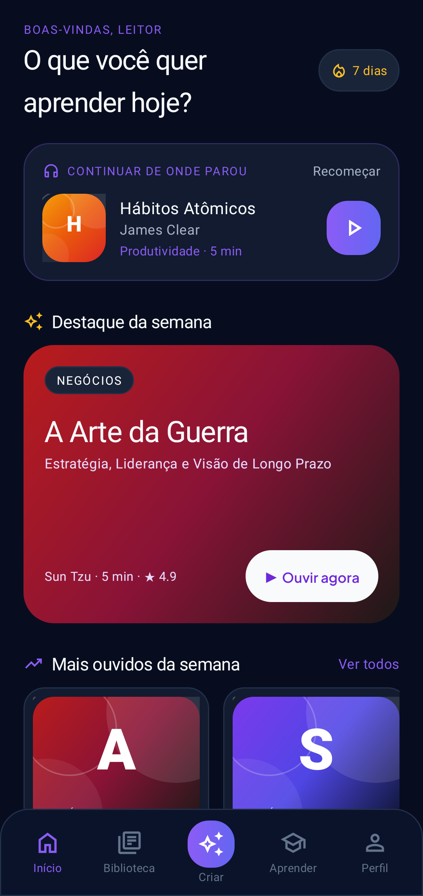
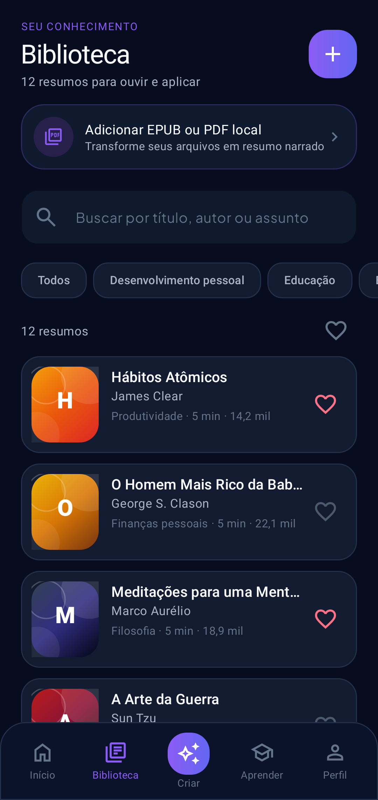
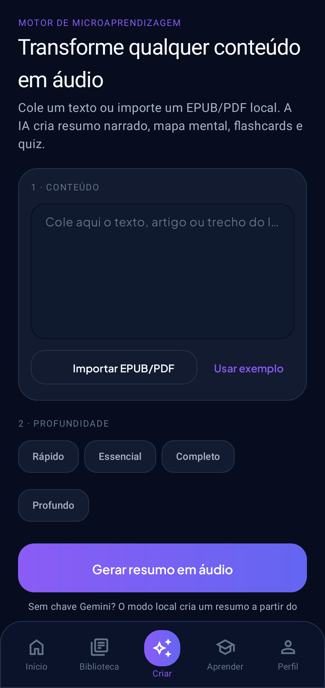
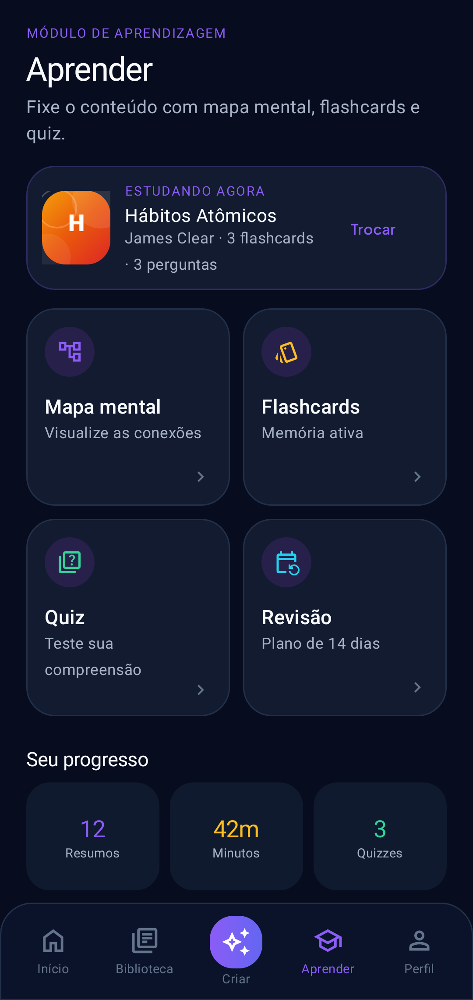
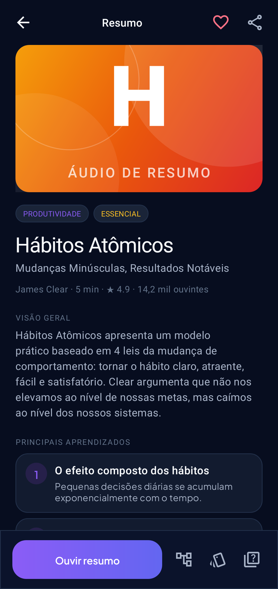
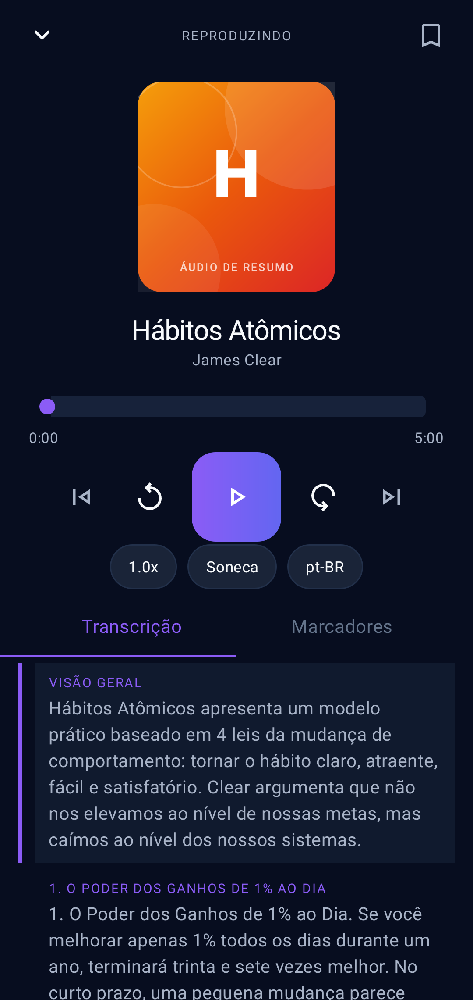
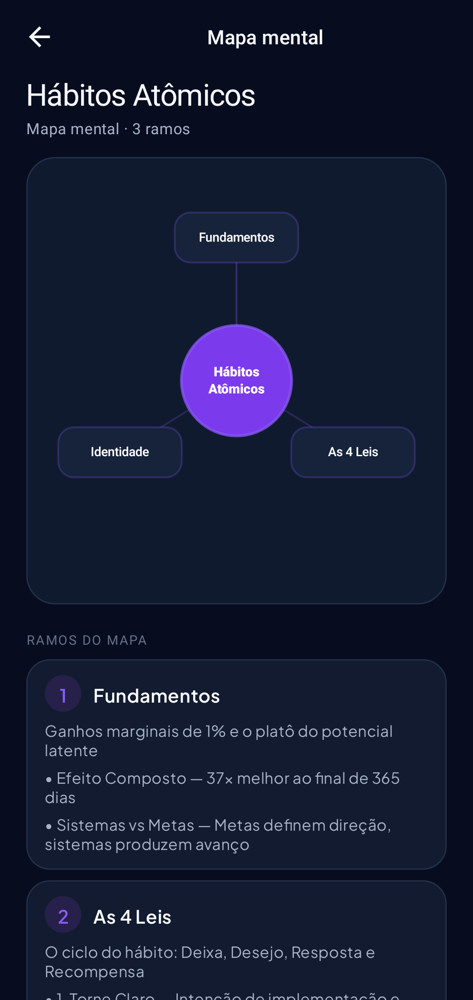
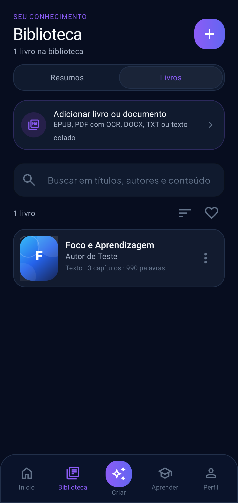
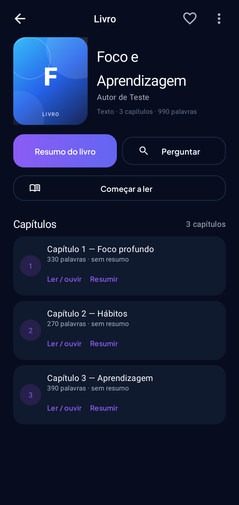
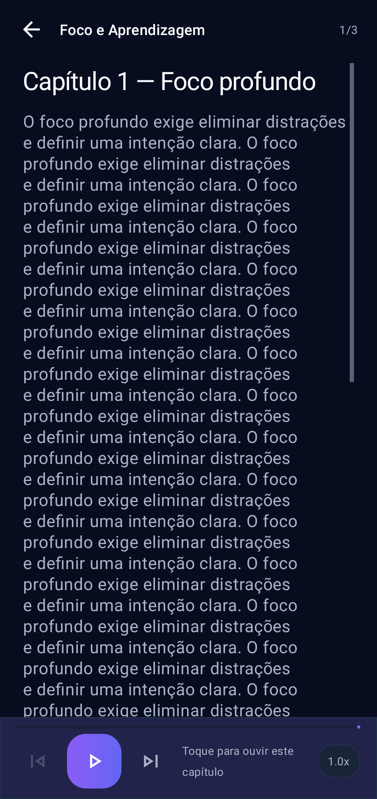

# Áudio de Resumo — Android nativo

[](https://github.com/aldecirv/audio-resumo-android/releases/latest)
[](https://github.com/aldecirv/audio-resumo-android/actions/workflows/build.yml)

Aplicativo Android nativo de **leitura, resumo e aprendizagem com IA**: importe **livros completos** (EPUB, PDF com texto ou OCR, DOCX, TXT e texto colado), leia por capítulos, ouça a narração, gere resumos do livro e de cada capítulo, faça perguntas ao livro e estude com mapa mental, flashcards e quiz.

Convertido do app web React/Express para **Kotlin + XML + Material 3**, com dados locais, processamento em blocos e IA opcional.



## Auditoria

O projeto passou por uma auditoria antes desta atualização. O relatório com recursos bloqueados/incompletos e o que foi implementado está em [AUDIT.md](AUDIT.md).

## Recursos

- **Biblioteca de livros** separada dos resumos curados: importe, pesquise, favorite, ordene, renomeie e exclua livros.
- **Importação de livros completos**:
  - **EPUB** por capítulos do spine/OPF, preservando a ordem;
  - **PDF com texto** extraído página a página;
  - **PDF digitalizado com OCR** (ML Kit via Google Play Services + PdfRenderer, processamento local por página);
  - **DOCX** (parágrafos e metadados);
  - **TXT** e **texto colado**;
  - sem limite artificial de páginas; somente limites técnicos de memória/tamanho e processamento em blocos.
- **Resumo do livro inteiro** por map-reduce em blocos (Gemini) com progresso real, retomada e fallback local claramente identificado.
- **Resumo individual por capítulo**, com áudio, mapa mental, flashcards e quiz reaproveitando o módulo de aprendizagem.
- **Leitor por capítulo** com narração TTS, velocidade, avanço automático de capítulos e retomada de posição.
- **Perguntas e respostas** sobre o livro, com citação de capítulos; modo local extrativo quando não há chave.
- **Durações 5, 10, 15 e 20 minutos**, todas disponíveis sem paywall ou bloqueio.
- **Biblioteca curada** com 12 resumos editoriais (Hábitos Atômicos, A Arte da Guerra, Sapiens etc.), claramente separados dos livros importados.
- **Player de áudio nativo** com `TextToSpeech` em pt-BR:
  - reprodução em segundo plano com notificação e controles;
  - velocidade 0,75x–2,0x, soneca, marcadores e transcrição sincronizada;
  - retomada de onde parou e progresso salvo.
- **Resumo com IA (opcional)**:
  - cole um texto ou importe um arquivo e gere resumo, mapa mental, flashcards e quiz com Gemini;
  - **modo local offline** (extrativo) quando não há chave configurada;
  - chave e modelo configuráveis em **Perfil** (armazenados apenas no aparelho).
- **Importação local e leitura**:
  - botão **+** e cartão **“Adicionar livro ou documento”** na Biblioteca;
  - EPUB: leitura de `container.xml`, OPF, spine e capítulos XHTML;
  - PDF: extração de texto com PDFBox e OCR local para páginas digitalizadas;
  - DOCX e TXT;
  - livro salvo no aparelho antes da geração do resumo; texto por capítulo em arquivos separados.
- **Aprendizagem ativa**: mapa mental radial, flashcards com virar de cartão e quiz com correção/explicação e pontuação salva.
- **Plano de revisão espaçada** em 1, 3, 7 e 14 dias.
- **Perfil**: estatísticas, plano Premium demonstrativo, painel administrativo com métricas e limpeza de histórico/cache.
- Tema escuro, tipografia Plus Jakarta Sans, capas geradas por gradiente.

| Biblioteca | Criar | Aprender |
|---|---|---|
|  |  |  |

| Detalhe | Player | Mapa mental |
|---|---|---|
|  |  |  |

| Livros | Detalhe do livro | Leitor por capítulo |
|---|---|---|
|  |  |  |

## Como usar

1. Abra o app e navegue pela **Biblioteca**.
2. Toque em um resumo para ver a visão geral, seções e conceitos.
3. Toque em **Ouvir resumo** para iniciar a narração.
4. Em **Criar**, cole um texto (ou toque em **Usar exemplo**) e gere um resumo. Sem chave, o modo local funciona offline.
5. Na **Biblioteca**, toque no **+** para importar **PDF**, **EPUB** ou **TXT** do aparelho.
6. Em **Aprender**, estude com mapa mental, flashcards, quiz e plano de revisão.
7. Em **Perfil**, configure a chave Gemini, o modelo, a velocidade da narração e o plano.

### Chave Gemini (opcional)

- Obtenha uma chave em <https://aistudio.google.com/apikey>.
- No app: **Perfil → Chave Gemini**.
- Sem chave, o app continua funcionando com o resumidor local e a biblioteca curada.

## Arquitetura

- Kotlin, `minSdk 24`, `targetSdk 35`, AGP 8.7.3, Kotlin 2.0.21.
- Activities + Fragments, ViewBinding, Material 3.
- Persistência local em `SharedPreferences` (JSON) — sem conta obrigatória e sem servidor.
- `SpeechService` em primeiro plano com `TextToSpeech`, notificação e `SpeechController` (StateFlow).
- `GeminiClient` (OkHttp + JSON) e `LocalSummarizer` como fallback offline.
- `BookStore` (metadados em JSON e texto por capítulo em arquivos) e `BookImporter` (EPUB/PDF/OCR/DOCX/TXT/texto).
- `BookProcessor` (map-reduce, capítulos, Q&A) e `BookProcessingService` (primeiro plano, progresso e retomada).
- `ImportFlow` mantido para resumos avulsos.
- Testes Robolectric: importação EPUB/PDF/DOCX/TXT, processamento local do livro e capítulo, Q&A, busca, persistência e screenshots.

```
app/src/main/java/com/audioresumo/app/
├── data/        modelos, Store, BookStore, Book, biblioteca
├── service/     SpeechService, BookProcessingService, SpeechController
├── ui/          Main, BookDetail, BookReader, BookQa, BookImport, Player, MindMap,
│                Flashcards, Quiz, ReviewPlan, SummaryDetail
├── ui/fragments Home, Library (Resumos/Livros), Create, Learn, Profile
├── ui/widgets/  CoverView, MindMapView
└── util/        GeminiClient, LocalSummarizer, ImportFlow, BookImporter, BookProcessor
```

## Build

Requisitos: JDK 17+ e Android SDK 35.

```bash
export JAVA_HOME=/caminho/para/jdk-17
gradle :app:assembleDebug
```

APK de release assinado:

```bash
export AURORA_KEYSTORE_PATH=/caminho/aurora.jks
export AURORA_KEYSTORE_PASS=...
export AURORA_KEY_ALIAS=aurora
export AURORA_KEY_PASS=...
gradle :app:assembleRelease
```

O CI (`.github/workflows/build.yml`) usa os mesmos secrets `AURORA_*` dos outros apps e publica o APK como artifact.

## Privacidade

- Biblioteca, progresso, marcadores e textos importados ficam no aparelho.
- A chave Gemini fica nas preferências locais e só é usada quando você gera um resumo com IA.
- Nenhum PDF/EPUB é enviado a servidores no modo local; com IA, o conteúdo é enviado à API do Google Gemini.

## Limitações

- A voz e o offline do TTS dependem do motor de síntese instalado no aparelho.
- EPUBs com DRM não são suportados.
- A qualidade do OCR depende da digitalização e do modelo ML Kit; a primeira leitura pode baixar o módulo pelo Google Play Services. Páginas muito ruins podem não ser reconhecidas.
- Em PDFs sem sumário, a detecção de capítulos é heurística; sem títulos, o app cria blocos de páginas rotulados (não inventa capítulos).
- O resumo local é extrativo e identificado como local; não é apresentado como resumo integral de IA.
- O plano Premium é demonstrativo (sem cobrança real) nesta versão.
- A sincronização em nuvem/Firebase do app web não foi portada; os dados são locais.

## Versão

**2.0.0** — plataforma completa de livros: importação de EPUB/PDF (texto + OCR)/DOCX/TXT/texto, biblioteca de livros, resumos do livro e por capítulo, leitor TTS, Q&A, busca, organização e durações 5/10/15/20 sem bloqueios.

APK: [**audio-resumo-2.0.0.apk**](https://github.com/aldecirv/audio-resumo-android/releases/download/v2.0.0/audio-resumo-2.0.0.apk) · [Release v2.0.0](https://github.com/aldecirv/audio-resumo-android/releases/tag/v2.0.0)
